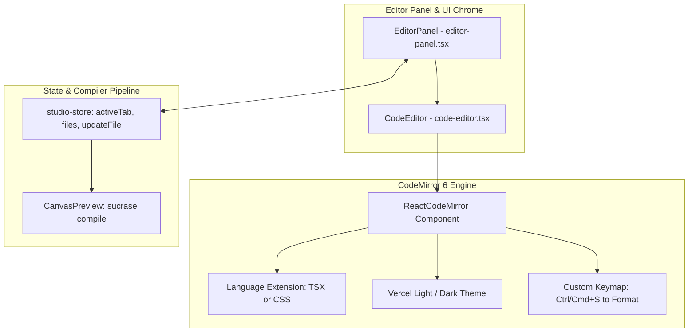

# Lightweight Code Editor (CodeMirror 6) Implementation Plan

> **For agentic workers:** REQUIRED SUB-SKILL: Use superpowers:subagent-driven-development to implement this plan task-by-task. Steps use checkbox (`- [ ]`) syntax for tracking.

**Goal:** Replace Monaco Editor with lightweight CodeMirror 6 to eliminate 6MB+ bundle overhead, remove background web workers, and make the editor load instantaneously.

**Architecture:** We will install `@uiw/react-codemirror` and official `@codemirror/lang-*` extensions, craft custom Vercel Light and Dark theme extensions that preserve the existing aesthetic, wrap them in a modular `components/studio/code-editor.tsx` component, swap the integration in `components/studio/editor-panel.tsx`, and safely purge Monaco dependencies.

**Architecture Diagram:**



**Tech Stack:** Next.js 16, React 19, `@uiw/react-codemirror`, `@codemirror/lang-javascript`, `@codemirror/lang-css`, `@codemirror/view`, `@codemirror/theme-one-dark` or custom `createTheme`, Tailwind CSS, Geist Mono font.

**Spec:** [`docs/superpowers/specs/2026-10-19-codemirror-lightweight-editor-design.md`](file:///c:/Users/ASUS/Desktop/CP/docs/superpowers/specs/2026-10-19-codemirror-lightweight-editor-design.md)

## Global Constraints

- **Typography Compliance:** Follow `AGENTS.md` strictly. Geist Mono (`var(--font-geist-mono)`) is allowed ONLY inside raw code/editor lines; all surrounding tabs, status text, and buttons must remain Geist Sans (`font-sans`).
- **UI Components:** Always use official `@/components/ui/*` primitives.
- **Zero Errors:** `bun x tsc --noEmit` must pass with 0 errors at the end of each task.
- **Save/Format Shortcut:** Must preserve <kbd>Ctrl+S</kbd> / <kbd>Cmd+S</kbd> for in-editor formatting.

---

### Task 1: Package Management (Install CodeMirror & Remove Monaco)

**Files:**
- Modify: [`package.json`](file:///c:/Users/ASUS/Desktop/CP/package.json)

**Interfaces:**
- Consumes: npm registry packages
- Produces: Installed `@uiw/react-codemirror`, `@codemirror/lang-javascript`, `@codemirror/lang-css` and removed `@monaco-editor/react`.

- [ ] **Step 1: Install CodeMirror packages using bun**
```bash
bun add @uiw/react-codemirror @codemirror/lang-javascript @codemirror/lang-css
```

- [ ] **Step 2: Remove Monaco Editor package**
```bash
bun remove @monaco-editor/react
```

- [ ] **Step 3: Verify package.json dependencies and lockfile**
Ensure `package.json` contains `@uiw/react-codemirror` and no longer contains `@monaco-editor/react`.

- [ ] **Step 4: Commit package changes**
```bash
git add package.json bun.lock
git commit -m "build: swap monaco-editor dependency with codemirror 6"
```

---

### Task 2: Create Custom Vercel Themes and CodeEditor Component

**Files:**
- Create: [`components/studio/code-editor.tsx`](file:///c:/Users/ASUS/Desktop/CP/components/studio/code-editor.tsx)

**Interfaces:**
- Consumes: `StudioFileName` from `@/lib/store/studio-store`
- Produces: `CodeEditor` component with interface:
  ```typescript
  export interface CodeEditorProps {
    filename: StudioFileName;
    value: string;
    onChange: (value: string) => void;
    onFormat?: () => void;
  }
  ```

- [ ] **Step 1: Write `components/studio/code-editor.tsx`**
Implement the component with:
1. Dynamic language extension selection:
   - `.tsx` / `.ts` -> `javascript({ jsx: true, typescript: true })`
   - `.css` -> `css()`
   - Default -> `javascript()`
2. Custom Vercel Light and Dark syntax highlighting extensions matching exact color specifications:
   - Light: Background `#ffffff`, foreground `#171717`, cursor `#0070f3`, selection `#d3e5ff`, keywords `#0070f3`, strings `#7928ca`, tags `#eb367f`.
   - Dark: Background `#0a0a0a`, foreground `#ededed`, cursor `#0070f3`, selection `#27272a`, keywords `#ff0080`, strings `#50e3c2`, tags `#7928ca`.
3. Dark mode detection syncing with `document.documentElement.classList.contains("dark")`.
4. Custom keymap for Save & Format (`Mod-s` / `Ctrl+S` / `Cmd+S` -> call `onFormat?.()`).
5. Font styling using `var(--font-geist-mono)` with 13px font size and 22px line height.

- [ ] **Step 2: Run type check**
```bash
bun x tsc --noEmit
```
Expected: PASS (0 TypeScript errors for `code-editor.tsx`).

- [ ] **Step 3: Commit code-editor component**
```bash
git add components/studio/code-editor.tsx
git commit -m "feat(studio): add lightweight CodeMirror 6 editor with vercel themes"
```

---

### Task 3: Integrate CodeEditor into EditorPanel

**Files:**
- Modify: [`components/studio/editor-panel.tsx`](file:///c:/Users/ASUS/Desktop/CP/components/studio/editor-panel.tsx)
- Modify: [`components/studio/canvas-preview.tsx`](file:///c:/Users/ASUS/Desktop/CP/components/studio/canvas-preview.tsx)

**Interfaces:**
- Consumes: `<CodeEditor>` from `./code-editor`
- Produces: Working editor panel replacing the old Monaco instance.

- [ ] **Step 1: Replace MonacoCodeEditor import in `editor-panel.tsx`**
```diff
-import { MonacoCodeEditor } from "./monaco-editor";
+import { CodeEditor } from "./code-editor";
```

- [ ] **Step 2: Replace JSX usage in `editor-panel.tsx`**
```diff
       {/* Editor Body */}
       <div className="flex-1 relative overflow-hidden bg-background">
-        <MonacoCodeEditor
+        <CodeEditor
           filename={activeTab}
           value={files[activeTab]}
           onChange={(newVal) => updateFile(activeTab, newVal)}
           onFormat={handleFormat}
         />
       </div>
```

- [ ] **Step 3: Update Monaco references in comments**
Update `components/studio/canvas-preview.tsx:69`:
```diff
-  // Debounce files (200ms) to ensure butter-smooth 60fps typing in Monaco without compiling on every single keystroke
+  // Debounce files (200ms) to ensure butter-smooth 60fps typing in CodeMirror without compiling on every single keystroke
```

- [ ] **Step 4: Run type check**
```bash
bun x tsc --noEmit
```
Expected: PASS (0 TypeScript errors).

- [ ] **Step 5: Commit editor-panel integration**
```bash
git add components/studio/editor-panel.tsx components/studio/canvas-preview.tsx
git commit -m "feat(studio): integrate CodeEditor into EditorPanel"
```

---

### Task 4: Clean Up Monaco Artifacts & Final Verification

**Files:**
- Delete: [`components/studio/monaco-editor.tsx`](file:///c:/Users/ASUS/Desktop/CP/components/studio/monaco-editor.tsx)

- [ ] **Step 1: Remove obsolete `components/studio/monaco-editor.tsx`**
Delete the old Monaco editor component file.

- [ ] **Step 2: Run full TypeScript check**
```bash
bun x tsc --noEmit
```
Expected: 0 errors.

- [ ] **Step 3: Test Next.js build verification**
```bash
bun run build
```
Expected: Build succeeds, verifying no broken imports or SSR hydration issues with CodeMirror.

- [ ] **Step 4: Commit cleanup**
```bash
git rm components/studio/monaco-editor.tsx
git commit -m "chore(studio): remove deprecated monaco-editor component"
```
