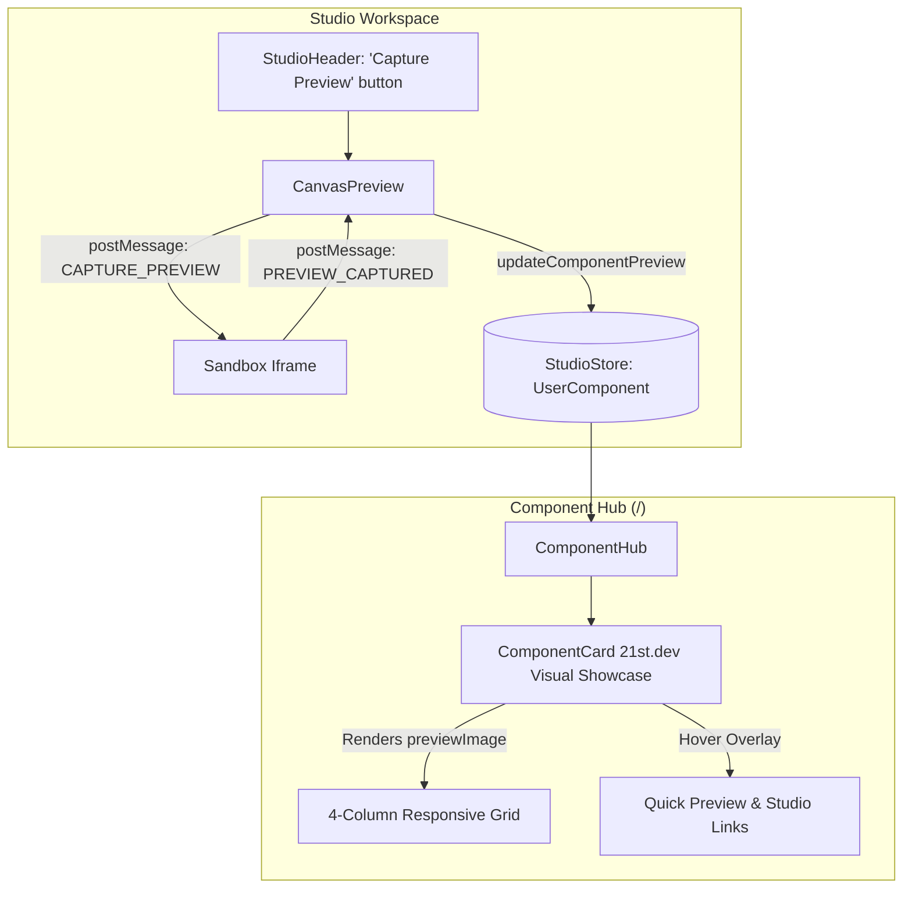

# 21st.dev Visual Grid System & Component Screenshot Capture Implementation Plan

> **For agentic workers:** REQUIRED SUB-SKILL: Use superpowers:subagent-driven-development to implement this plan task-by-task. Steps use checkbox (`- [ ]`) syntax for tracking.

**Goal:** Build a 21st.dev-style visual-first component grid system where cards prominently showcase component previews/screenshots, with 1-click live canvas screenshot capture in Studio and custom image upload.

**Architecture:**
- **Store & Registry:** Extend `UserComponent` with `previewImage?: string;`, pre-seeded with crisp SVG mockups for all built-in starter templates, and an `updateComponentPreview` action.
- **In-Iframe Canvas Snapshot:** A lightweight snapshot protocol in `sandbox-compiler.ts` that captures the rendered `#root` DOM/Canvas into a PNG data URL upon receiving `CAPTURE_PREVIEW` and returns `PREVIEW_CAPTURED`.
- **Studio Header & Checkpoint Dialog:** 1-click "📸 Capture Preview" button in `StudioHeader` and automatic canvas capture on checkpoint save.
- **Visual Card Redesign:** `ComponentCard` redesigned into a 21st.dev visual canvas showcase (matching user reference image) with an aspect ratio preview frame, smooth hover lift, and sleek overlay metadata/actions.

**Architecture Diagram:**



**Tech Stack:** Next.js 16 (App Router), React 19, Tailwind CSS, Zustand, Lucide React, HTML5 Canvas / SVG foreignObject, Bun.

**Spec:** [`docs/superpowers/specs/2026-10-20-visual-grid-and-screenshot-capture-design.md`](file:///c:/Users/ASUS/Desktop/CP/docs/superpowers/specs/2026-10-20-visual-grid-and-screenshot-capture-design.md)

## Global Constraints

- ALL UI text (titles, descriptions, buttons, badges, counts, filters) MUST use Geist Sans (`font-sans`).
- Geist Mono (`font-mono`) is strictly restricted to mono eyebrows (`Badge variant="eyebrow"`).
- Use official shadcn/ui primitives (`@/components/ui/*`). No raw HTML buttons.
- 0 TypeScript errors (`bun x tsc --noEmit`).
- 0 ESLint errors (`bun run lint`).
- 100% test pass rate (`bun test`).

---

### Task 1: Store & Data Model Extension (`lib/store/studio-store.ts`)

**Files:**
- Modify: `lib/store/studio-store.ts`
- Modify: `lib/store/__tests__/component-registry-store.test.ts`

**Interfaces:**
- Produces:
  - `UserComponent.previewImage?: string`
  - `updateComponentPreview: (id: string, previewImage: string) => void`
  - Starter templates seeded with default SVG preview thumbnails.

- [ ] **Step 1: Write the failing unit tests for `updateComponentPreview` and template previews**

Add to `lib/store/__tests__/component-registry-store.test.ts`:
```typescript
it("should update component preview image and persist timestamp", () => {
  const store = useStudioStore.getState();
  const id = store.createComponent({ name: "Card With Preview" });
  const sampleDataUrl = "data:image/svg+xml;base64,PHN2Zz48L3N2Zz4=";

  store.updateComponentPreview(id, sampleDataUrl);
  const state = useStudioStore.getState();
  expect(state.userComponents[id].previewImage).toBe(sampleDataUrl);
});

it("should seed default templates with preview images", () => {
  const store = useStudioStore.getState();
  const hero = store.userComponents["ink-orbit-hero"];
  expect(hero).toBeDefined();
  expect(hero.previewImage).toBeDefined();
  expect(hero.previewImage).toContain("data:image/svg+xml");
});
```

- [ ] **Step 2: Run test to verify it fails**
Run: `bun test lib/store/__tests__/component-registry-store.test.ts`
Expected: FAIL

- [ ] **Step 3: Implement in `lib/store/studio-store.ts`**
  - Add `previewImage?: string;` to `UserComponent` interface.
  - Define high-fidelity default preview SVG data URLs for `ink-orbit-hero`, `spotlight-card`, `shimmer-button`, `metric-badge`, and `blank`.
  - In `DEFAULT_TEMPLATES` seeding, populate `previewImage`.
  - Implement `updateComponentPreview(id, previewImage)` in `useStudioStore` slice.

- [ ] **Step 4: Run test to verify it passes**
Run: `bun test lib/store/__tests__/component-registry-store.test.ts`
Expected: PASS

- [ ] **Step 5: Run typecheck & commit**
Run: `bun x tsc --noEmit`
Commit: `git commit -am "feat(store): add previewImage to UserComponent with updateComponentPreview action and seed thumbnails"`

---

### Task 2: Live Canvas Snapshot Capture Protocol in Sandbox (`lib/sandbox/sandbox-compiler.ts`)

**Files:**
- Modify: `lib/sandbox/sandbox-compiler.ts`
- Test: `lib/sandbox/__tests__/sandbox-capture.test.ts`

**Interfaces:**
- Produces:
  - In-iframe message handler for `event.data.type === "CAPTURE_PREVIEW"`.
  - Captures `#root` DOM element or canvas, creates PNG data URL.
  - Calls `notifyParent({ type: "PREVIEW_CAPTURED", dataUrl })`.

- [ ] **Step 1: Write test for snapshot script compilation**
Create `lib/sandbox/__tests__/sandbox-capture.test.ts`:
```typescript
import { describe, it, expect } from "bun:test";
import { compileSandboxHtml } from "../sandbox-compiler";

describe("Sandbox Preview Capture Protocol", () => {
  it("should embed CAPTURE_PREVIEW listener and capture helper in compiled sandbox HTML", () => {
    const res = compileSandboxHtml(
      "export default function Test() { return <div>Test</div> }",
      "",
      "",
      []
    );
    expect(res.error).toBeNull();
    expect(res.html).toContain("CAPTURE_PREVIEW");
    expect(res.html).toContain("PREVIEW_CAPTURED");
  });
});
```

- [ ] **Step 2: Run test to verify it fails**
Run: `bun test lib/sandbox/__tests__/sandbox-capture.test.ts`
Expected: FAIL

- [ ] **Step 3: Implement in `lib/sandbox/sandbox-compiler.ts`**
  - Inside the module script of `compileSandboxHtml`:
    - Add `captureRootPreview()` function that reads `#root`, renders to an offscreen canvas using SVG `foreignObject` (or clones canvas if `#root` contains `<canvas>`), converts to PNG data URL via `canvas.toDataURL("image/png")`.
    - In the `window.addEventListener("message")` handler:
      - If `event.data.type === "CAPTURE_PREVIEW"`, execute `captureRootPreview()` and call `notifyParent({ type: "PREVIEW_CAPTURED", dataUrl, componentId: event.data.componentId })`.

- [ ] **Step 4: Run test to verify it passes**
Run: `bun test lib/sandbox/__tests__/sandbox-capture.test.ts`
Expected: PASS

- [ ] **Step 5: Commit**
Commit: `git commit -am "feat(sandbox): add in-iframe DOM-to-canvas screenshot capture protocol"`

---

### Task 3: Studio Header Capture Button & CanvasPreview Integration

**Files:**
- Modify: `components/studio/canvas-preview.tsx`
- Modify: `components/studio/studio-header.tsx`
- Test: `components/studio/__tests__/studio-header-navigation.test.tsx`

**Interfaces:**
- Consumes: `updateComponentPreview` from `useStudioStore`, `PREVIEW_CAPTURED` message from iframe.
- Produces:
  - `StudioHeader`: "📸 Capture Preview" button (`<Button variant="ghost" size="sm">` with `<Camera className="size-3.5" />`).
  - Clicking sends `CAPTURE_PREVIEW` to `iframeRef.current.contentWindow`.
  - `CanvasPreview` listens for `PREVIEW_CAPTURED` and calls `updateComponentPreview(currentTemplateId, dataUrl)`.
  - Button exhibits a temporary check/success feedback for 2 seconds (`"Preview Saved!"`).

- [ ] **Step 1: Write test for Capture Preview button in StudioHeader**
Modify `components/studio/__tests__/studio-header-navigation.test.tsx`:
```typescript
it("should render 'Capture Preview' button in studio header", () => {
  const html = renderToString(<StudioHeader />);
  expect(html).toContain("Capture");
});
```

- [ ] **Step 2: Run test to verify it fails**
Run: `bun test components/studio/__tests__/studio-header-navigation.test.tsx`
Expected: FAIL

- [ ] **Step 3: Implement in `components/studio/canvas-preview.tsx` and `components/studio/studio-header.tsx`**
  - In `canvas-preview.tsx`:
    - Listen for `event.data.type === "PREVIEW_CAPTURED"`.
    - Extract `dataUrl` and call `updateComponentPreview(currentTemplateId, event.data.dataUrl)`.
    - Add an event listener or custom event so `StudioHeader` can trigger capture on the active iframe.
  - In `studio-header.tsx`:
    - Add `"Capture Preview"` button with `<Camera className="size-3.5" />`.
    - Manage `isCapturing` and `capturedSuccess` temporary state.
    - Dispatch capture command to window/iframe.

- [ ] **Step 4: Run test to verify it passes**
Run: `bun test components/studio/__tests__/studio-header-navigation.test.tsx`
Expected: PASS

- [ ] **Step 5: Commit**
Commit: `git commit -am "feat(studio): add capture preview button in studio header with iframe integration"`

---

### Task 4: 21st.dev Visual Grid Component Card (`ComponentCard` & `ComponentHub`)

**Files:**
- Modify: `components/hub/component-card.tsx`
- Modify: `components/hub/component-hub.tsx`
- Test: `components/hub/__tests__/component-card.test.tsx`
- Test: `components/hub/__tests__/component-hub.test.tsx`

**Interfaces:**
- Consumes: `component.previewImage` from `UserComponent`.
- Produces:
  - `ComponentCard`:
    - Aspect ratio visual showcase frame (`aspect-[16/10]` or `h-48`).
    - Renders `previewImage` (or styled fallback SVG) centered with smooth hover zoom.
    - Smooth hover overlay revealing component title, category badge, and 1-click "Preview" & "Studio" buttons.
    - Responsive 4-column cards grid in `ComponentHub`.

- [ ] **Step 1: Update component card test to assert preview image rendering**
Modify `components/hub/__tests__/component-card.test.tsx` (or `component-hub.test.tsx`):
```typescript
it("should render component preview image when previewImage is provided", () => {
  const componentWithPreview = {
    ...sampleComponent,
    previewImage: "data:image/svg+xml;base64,PHN2Zz48L3N2Zz4=",
  };
  const html = renderToString(<ComponentCard component={componentWithPreview} />);
  expect(html).toContain('data:image/svg+xml;base64');
  expect(html).toContain('img');
});
```

- [ ] **Step 2: Run test to verify it fails**
Run: `bun test components/hub/__tests__/component-hub.test.tsx`
Expected: FAIL

- [ ] **Step 3: Implement Visual Showcase Card in `components/hub/component-card.tsx`**
  - Redesign card surface to match the reference image:
    - Neutral/light surface canvas box with `overflow-hidden` and `rounded-xl`.
    - Renders ``.
    - If no `previewImage`, renders elegant centered fallback pill.
    - Overlay bar at bottom on hover with title, category badge, "Preview" button, "Studio" button, and options menu.
  - Update `ComponentHub` grid layout styling for 4 columns: `grid grid-cols-1 sm:grid-cols-2 lg:grid-cols-3 xl:grid-cols-4 gap-5`.

- [ ] **Step 4: Run test to verify it passes**
Run: `bun test components/hub/__tests__/component-hub.test.tsx`
Expected: PASS

- [ ] **Step 5: Commit**
Commit: `git commit -am "feat(hub): redesign component card into 21st.dev visual showcase grid"`

---

### Task 5: Comprehensive Verification, Type Safety, and Linting

**Files:**
- Run: `bun test`
- Run: `bun x tsc --noEmit`
- Run: `bun run lint`

- [ ] **Step 1: Run full test suite**
Run: `bun test`
Verify: All tests pass (0 failures).

- [ ] **Step 2: Run TypeScript compiler**
Run: `bun x tsc --noEmit`
Verify: 0 errors.

- [ ] **Step 3: Run ESLint**
Run: `bun run lint`
Verify: 0 errors.

- [ ] **Step 4: Commit any remaining polish and update progress tracking**
Commit: `git commit -am "chore: complete 21st.dev visual grid and screenshot capture verification"`
