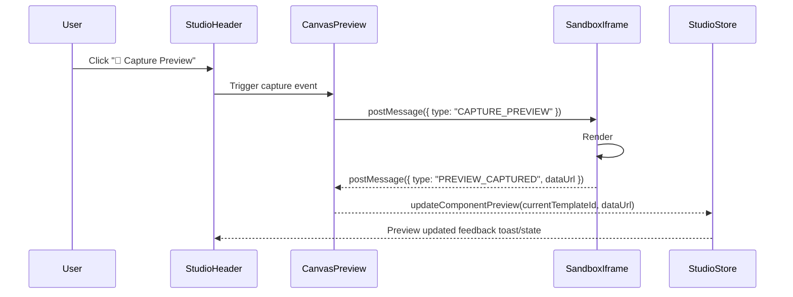

# Design Specification: 21st.dev Visual Grid System & Component Screenshot Capture

**Date:** 2026-10-20  
**Status:** Approved  
**Author:** Pair Programming Agent  

---

## 1. Overview & Motivation

In modern component galleries like 21st.dev, Mobbin, and Dribbble, component cards are visual-first. Instead of text-heavy cards, each card showcases the rendered visual output of the component on a clean backdrop.

This specification addresses two key requirements:
1. **21st.dev Visual Grid System**: Transform the component cards in the root library dashboard (`/`) into visual canvas cards showing the component's actual preview image with sleek hover overlay metadata and quick actions.
2. **Auto Screenshot & Preview Capture**: Enable 1-click live canvas screenshot capture in the Studio header, automatic preview capture during checkpoint saving, custom image uploads/URLs, and high-fidelity seed thumbnails for starter templates.

---

## 2. Architecture & Components



---

## 3. Data Model & Store State

### 3.1 Model Updates (`lib/store/studio-store.ts`)
Add `previewImage` to `UserComponent`:
```typescript
export interface UserComponent {
  id: string;
  name: string;
  description: string;
  category: string;
  isBuiltIn?: boolean;
  createdAt: number;
  updatedAt: number;
  files: {
    "component.tsx": string;
    "demo.tsx": string;
    "index.css": string;
  };
  dependencies: string[];
  previewImage?: string; // Base64 data URL or external image URL
}
```

### 3.2 Store Actions
- `updateComponentPreview: (id: string, previewImage: string) => void`
  - Updates `userComponents[id].previewImage`.
  - Sets `updatedAt = Date.now()`.
  - Persists state cleanly via Zustand persist middleware.

### 3.3 Default Starter Template Previews
Pre-generate crisp SVG data URIs for all 5 default templates (`ink-orbit-hero`, `spotlight-card`, `shimmer-button`, `metric-badge`, `blank`) so the gallery looks rich out of the box before custom screenshots are captured.

---

## 4. Canvas Screenshot Capture System

### 4.1 In-Iframe Capture Protocol (`lib/sandbox/sandbox-compiler.ts`)
Inside the sandboxed iframe runtime:
1. Listen for `window.addEventListener("message")` with `event.data.type === "CAPTURE_PREVIEW"`.
2. Locate `#root` inside the iframe DOM.
3. If `#root` contains an HTML5 `<canvas>` (e.g. 3D physics heroes), call `canvas.toDataURL("image/png")`.
4. For DOM/Tailwind elements, create an SVG `foreignObject` containing the cloned styled DOM subtree, serialize to image, draw to a hidden HTML5 canvas, and extract PNG data URL.
5. Send `notifyParent({ type: "PREVIEW_CAPTURED", dataUrl: pngDataUrl })`.

### 4.2 Studio Header Integration (`components/studio/studio-header.tsx`)
- Add a `"📸 Capture Preview"` button (`<Button variant="ghost" size="sm">` with `<Camera className="size-3.5" />`) in the Studio header action toolbar.
- On click:
  - Dispatches `postMessage({ type: "CAPTURE_PREVIEW" })` to the active iframe.
  - Shows an animated check/spinner feedback for 2 seconds (`"Preview Captured!"`).
  - Updates `previewImage` in the store.

### 4.3 Checkpoint Save Integration (`components/studio/save-checkpoint-dialog.tsx`)
- Include an option in `SaveCheckpointDialog` to:
  - Automatically update the component's preview image with the current canvas snapshot when saving a checkpoint.
  - Or manually upload / paste a custom thumbnail URL.

---

## 5. Visual Grid Card Redesign (`ComponentCard` & `ComponentHub`)

### 5.1 `ComponentCard` (`components/hub/component-card.tsx`)
Redesigned to match the reference image:
- **Card Container**:
  - Rounded corners (`rounded-xl`), subtle border (`border-border/60`), elevated shadow on hover.
  - Dark/neutral canvas background.
- **Visual Preview Surface**:
  - Prominent display area (`aspect-[16/10]` or `h-44 sm:h-48`).
  - Clean light or dark card background (configurable or matching theme).
  - Renders `component.previewImage` centered with smooth hover zoom (`group-hover:scale-[1.03] transition-transform duration-300`).
  - Fallback visual: If no preview image exists, renders an elegant centered visual badge pill with the category icon and component name on a micro-grid background.
- **Hover Chrome (21st.dev Style)**:
  - Resting state: clean, distraction-free visual presentation.
  - Hover state: reveals bottom overlay bar with:
    - Component title (`font-sans font-medium text-xs truncate`).
    - Category badge (`font-sans text-[10px]`).
    - Quick "Preview" button (opens 21st.dev quick modal).
    - Quick "Studio" button (opens editor).
    - More dropdown menu (Duplicate, Delete).

### 5.2 `ComponentHub` Grid Layout (`components/hub/component-hub.tsx`)
- Desktop 4-column responsive grid:
  `grid grid-cols-1 sm:grid-cols-2 lg:grid-cols-3 xl:grid-cols-4 gap-5`
- Preserves filter pills (`All`, `Recent Work`, `Heroes`, `Cards`, `Buttons`, `Badges`, `Custom`), search input, and work history metrics.

---

## 6. Strict Typography & UI Standards

Per `AGENTS.md`:
- **Default Font is Geist Sans (`font-sans`)**: All card titles, buttons, badges, status indicators, dropdowns, and header labels must use `font-sans`.
- **Geist Mono (`font-mono`)**: Strictly restricted to mono eyebrows (`Badge variant="eyebrow"`).
- **Official shadcn/ui Primitives**: Standard `@/components/ui/*` (`Button`, `Badge`, `DropdownMenu`, `Tooltip`, `Dialog`). No raw HTML buttons or unstyled spans.

---

## 7. Verification Plan

1. **Unit & Store Tests**:
   - `lib/store/__tests__/component-registry-store.test.ts`: test `updateComponentPreview` and template seed images.
   - `components/hub/__tests__/component-card.test.tsx`: test rendering of `previewImage`, fallback state, hover actions, and menu options.
   - `components/studio/__tests__/studio-header-navigation.test.tsx`: test Capture Preview button rendering and action dispatch.
2. **Type Safety & Lint**:
   - `bun x tsc --noEmit` -> 0 errors.
   - `bun run lint` -> 0 errors.
3. **Full Test Suite**:
   - `bun test` -> 100% pass rate.
