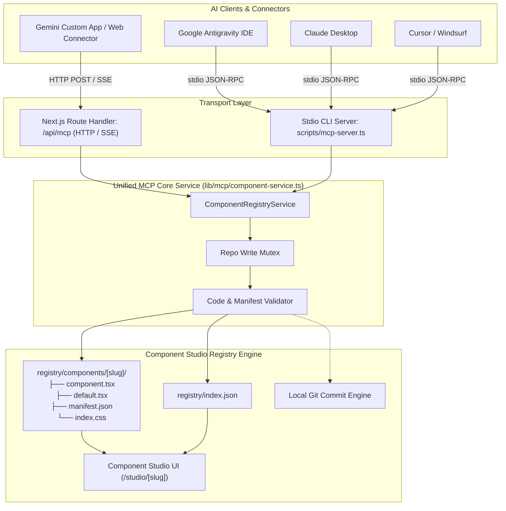

# Enterprise MCP Server Architecture & Gemini Connector Specification

**Spec ID:** `2026-11-21-enterprise-mcp-server-design`  
**Status:** Approved  
**Author:** Antigravity  
**Target:** Component Studio (`C:\Users\ASUS\Desktop\CP`)  

---

## 1. Executive Summary

Component Studio requires a production-grade, enterprise-ready **Model Context Protocol (MCP)** server architecture. This allows AI assistants (including Google Gemini, Claude Desktop, Antigravity IDE, Cursor, and custom Gemini agent connectors) to inspect, generate, update, and manage React 19 / Tailwind v4 components directly within the project's local registry.

The integration provides **Dual Transports**:
1. **Stdio Transport (`scripts/mcp-server.ts`)**: For desktop IDEs, CLI runners, and agent harnesses like Antigravity, Claude Desktop, and Cursor.
2. **HTTP / SSE Transport (`app/api/mcp/route.ts`)**: For remote web agents, Gemini Custom App Connectors, and webhook-driven integrations.

Both transports connect to a single **Unified MCP Service (`lib/mcp/component-service.ts`)** that encapsulates registry operations, file I/O security, schema validation, index synchronization, and optional Git commits.

---

## 2. Core Principles & Enterprise Standards

To match the standards of industry leaders (Anthropic, Figma, Vercel, Google):
1. **Full Protocol Adherence**: Conforms to the Model Context Protocol specification v1.x with JSON-RPC 2.0, providing Tools, Resources, and Prompts.
2. **Strict Security & Path Sanitization**: Zero directory traversal risk; all filesystem writes enforce sanitized slug boundaries within `registry/components/<slug>/`.
3. **Atomic Writes & Write Locks**: Employs serialized write locks to prevent concurrent index corruption during multi-file operations.
4. **Contract Validation**: Validates that generated code meets Component Studio contracts (e.g. `default.tsx` imports and renders `component.tsx`, TypeScript types are valid).
5. **Universal UI Integration**: Provides an in-app "Connect MCP" dialog in Component Studio displaying one-click copyable configuration snippets for Gemini, Antigravity, Claude, and Cursor.
6. **Typography & Styling Adherence**: Conforms strictly to `AGENTS.md` rules (`font-sans` for UI chrome, `font-mono` exclusively for code, slugs, commands, and AST).

---

## 3. System Architecture

---

## 4. MCP Primitives Specification

### 4.1 Tools

#### 1. `create_component`
Creates a brand-new component in the registry and makes it immediately available in Component Studio.
- **Input Schema:**
  - `name` (string, required): Human-readable component name (e.g., "Glow Hologram Card").
  - `slug` (string, optional): Kebab-case URL-safe slug. If omitted, derived from `name`.
  - `category` (string, required): Category (e.g., "Cards", "Buttons", "Navigation", "Hero", "Effects").
  - `description` (string, required): Concise explanation of functionality and aesthetics.
  - `componentCode` (string, required): Complete source code for `component.tsx`.
  - `defaultCode` (string, required): Complete source code for `default.tsx` rendering the preview.
  - `dependencies` (array of strings, optional): Required npm packages (e.g. `["framer-motion", "lucide-react"]`).
  - `css` (string, optional): Custom CSS for `index.css` (defaults to Tailwind base/components/utilities).
- **Execution Output:**
  - `success`: boolean
  - `slug`: string
  - `studioUrl`: string (e.g. `/studio/glow-hologram-card`)
  - `filesCreated`: array of string file paths
  - `message`: human-readable confirmation string

#### 2. `get_component`
Retrieves the full source code, manifest, dependencies, and file layout of any existing component.
- **Input Schema:**
  - `slug` (string, required): Slug or ID of the component.
- **Execution Output:**
  - `manifest`: Component manifest metadata.
  - `files`: Object with `component.tsx`, `default.tsx`, and `index.css`.
  - `studioUrl`: Relative URL to open in the studio.

#### 3. `list_components`
Returns a filtered or complete summary list of all components in the registry.
- **Input Schema:**
  - `category` (string, optional): Filter by category.
  - `search` (string, optional): Substring search across name, slug, and description.
  - `limit` (number, optional): Maximum items to return (default 50).
- **Execution Output:**
  - `total`: number
  - `components`: Array of summary records (id, slug, name, category, description, dependencies, previewImage).

#### 4. `update_component`
Safely updates code files, metadata, or dependencies for an existing component.
- **Input Schema:**
  - `slug` (string, required): Slug of the component to update.
  - `componentCode` (string, optional): New `component.tsx` content.
  - `defaultCode` (string, optional): New `default.tsx` content.
  - `css` (string, optional): New `index.css` content.
  - `description` (string, optional): Updated description.
  - `category` (string, optional): Updated category.
  - `dependencies` (array of strings, optional): Updated dependency list.
- **Execution Output:**
  - `success`: boolean
  - `updatedAt`: timestamp
  - `message`: string

#### 5. `delete_component`
Deletes a component directory and updates `registry/index.json`.
- **Input Schema:**
  - `slug` (string, required): Component slug.
  - `confirm` (boolean, required): Safety confirmation flag.

---

### 4.2 Resources

- `registry://index`: The full serialized `registry/index.json` catalog.
- `component://{slug}`: Dynamic resource template providing the complete code package for any component.

---

### 4.3 Prompts

- `create-component-guidelines`: System prompt guide outlining Component Studio's UI guidelines, React 19 rules, Tailwind v4 class standards, and default export requirements.

---

## 5. Security, Guardrails & Quality Assurance

1. **Path Traversal Protection**: Enforce `resolveSafeComponentDir(cwd, slug)` which verifies that paths never escape `registry/components/`.
2. **Rate Limiting & Authentication**:
   - HTTP transport supports optional `MCP_API_KEY` verification via `Authorization: Bearer <token>`.
   - Protects against brute-force calls with IP-based rate limiting.
3. **TypeScript Verification**: All new code and transports must pass `bun x tsc --noEmit` with zero errors.
4. **Automated Test Coverage**: Test suite in `tests/mcp/component-service.test.ts` verifying all 5 tools, input validation, and boundary conditions.
